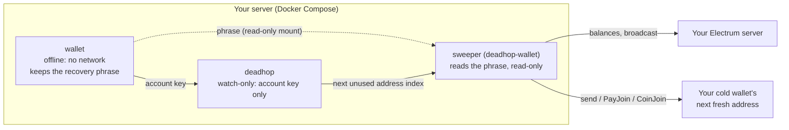

<div align="center">

<picture>
  <source media="(prefers-color-scheme: dark)" srcset="https://deadhop.run/docs/mark-fog.svg">
  
</picture>

# deadhop wallet

The optional sweeper: it moves what a deadhop service received to your cold wallet.

[](https://github.com/deadhop/wallet/actions/workflows/ci.yml)
[](LICENSE)
[](https://deadhop.run/docs/wallet/)

</div>

A [deadhop](https://github.com/deadhop/server) service is watch-only: it sees payments arrive
but cannot spend them. When you let it generate your wallet, the recovery phrase sits on the
same server, in an offline container. `deadhop-wallet` is the separate process that spends
from that wallet. Once the confirmed balance reaches a threshold you set, it moves the funds to
a fresh address of another wallet, in one of three ways:

| Mode | What happens |
|---|---|
| `send` (default) | One transaction pays every confirmed coin to the next unused address of `DEADHOP_WALLET_DESTINATION`. |
| `payjoin` | A [BIP-78](https://github.com/bitcoin/bips/blob/master/bip-0078.mediawiki) PayJoin with a receiver named by a `bitcoin:` URI that has a `pj=` endpoint. The receiver adds a coin of its own, so the transaction does not show which inputs are whose. |
| `coinjoin` | A [joinstr](https://docs.joinstr.xyz/protocol/) round over Nostr. The confirmed coins are first consolidated into one premix coin. That coin joins a pool of equal-amount peers, and the mixed output goes to the next destination address. |



A sweep, as the sweeper logs it (regtest):

```text
$ docker compose --profile sweep logs --no-log-prefix sweeper
11:52:35  INFO deadhop_wallet::run: holding 0 BTC confirmed and 0.00168000 BTC unconfirmed, below the threshold
11:53:05  INFO deadhop_wallet::run: holding 0 BTC confirmed and 0.00168000 BTC unconfirmed, below the threshold
11:53:35  INFO deadhop_wallet::run: send: moved 195273 sat of 203000 to bcrt1qkh5nhkj8an3c7vw8dlzyq4vzk07g90xjte5ah2 in cfdfa7a7…a71028c9

$ docker compose --profile sweep exec sweeper deadhop-wallet status
1795521215 send moved 195273 of 203000 sat to bcrt1qkh5nhkj8an3c7vw8dlzyq4vzk07g90xjte5ah2 in cfdfa7a7…a71028c9
```

## Quick start

The sweeper is the `sweeper` service in [deadhop/stack](https://github.com/deadhop/stack)'s
`compose.yaml`, behind the `sweep` profile. Add three lines to the stack's `.env`:

```sh
DEADHOP_WALLET_DESTINATION=zpub6…        # your cold wallet's account key
DEADHOP_WALLET_THRESHOLD_SAT=2000000     # sweep once 0.02 BTC is confirmed (at least 10,000)
DEADHOP_WALLET_MAX_FEE_RATE=20           # never pay more than 20 sat/vB; wait instead
```

```sh
docker compose --profile sweep up -d --build
docker compose --profile sweep logs sweeper
```

The destination and limits are read from that file only: nobody can change them over Nostr, the
dashboard included. The full guide: [Sweep to your cold wallet](https://deadhop.run/docs/wallet/sweep.html).

## How it works

- **The phrase:** the offline `wallet` service (`deadhop wallet serve`) generates and keeps the recovery
  phrase. This process reads the phrase, read-only. It never creates one, so a
  missing file can never turn into a new, empty wallet.
- **Startup check:** it refuses to start if the phrase does not belong to the account key the
  payment service watches (`DEADHOP_XPUB_FILE`).
- **Finding the coins:** the payment service gives every invoice its own address, and most
  invoices are never paid, so a gap-limit scan alone would miss funds. The payment service
  therefore writes its next unused address index to `DEADHOP_INDEX_FILE` after every poll. The
  wallet scans every address below it, plus `DEADHOP_WALLET_GAP` beyond the last used one.
- **Before every signature,** whoever built the transaction (this wallet, a PayJoin receiver or
  CoinJoin peers), the wallet checks three things:
  - it spends only its own coins, and their values are described correctly;
  - at least the expected amount reaches the approved scripts: the destination, or for a
    premix its own change;
  - it loses no more than the allowed cost: the fee cap for a send or a premix, the Original's
    fee for a PayJoin, and joinstr's 15,000 sat for a CoinJoin.
- **Destination and limits:** the destination, mode, threshold and fee cap are read from the
  environment only. Nothing that decides where money goes can be changed remotely. The sweep
  policy in the dashboard is a separate, stored setting and does not drive this process.
- **State:** `sweeper.json` in `DEADHOP_WALLET_STATE_DIR` records the next destination and
  change index, every PayJoin URI already paid (each is paid once), and the last 100 sweeps.

## When something fails

- **Many coins:** at most 400 inputs go into one transaction, largest first, and a coin worth
  less than the fee of its own input is left alone. The rest is swept by the next poll.

- **Fees above the cap, no fresh PayJoin URI, a CoinJoin round that does not fill:** the
  balance stays where it is, and the next poll tries again.
- **PayJoin receiver unreachable, answering with an error, or sending a proposal that fails a
  check:** the signed Original is broadcast instead. It is an ordinary payment to the
  receiver's address, and BIP-78 lets the receiver broadcast it too. The URI counts as used
  either way.
- **CoinJoin:** a signature is `ALL|ANYONECANPAY` over every output, so whatever set of inputs
  ends up combined, this wallet's output gets its amount, or the transaction is invalid. An
  abandoned round spends nothing.

## Limits of this version

- **joinstr compatibility:** the message flow and field names follow the joinstr spec, but
  PSBTs are version 0 (the bitcoin library has no version 2), and the LSAG recovery phase is
  not implemented.
- **Untested against other implementations:** interoperability with joinstr's Python and
  Kotlin clients has not been tested. Rounds have only been run between deadhop wallets.
- **PayJoin version:** PayJoin is BIP-78 (v1) only, with no BIP-77 directory or OHTTP.
- **Script type:** only P2WPKH (BIP-84) coins.
- **No CoinJoin fallback:** without enough peers, rounds keep being abandoned. The premix coin
  stays in the wallet and nothing leaves until a round fills, or you switch the mode.

## Configuration

| Variable | Default | Meaning |
|---|---|---|
| `DEADHOP_NETWORK` | `bitcoin` | `bitcoin`, `testnet`, `signet` or `regtest` |
| `DEADHOP_DATA_DIR` | `data` | Holds `wallet.mnemonic` (only read) |
| `DEADHOP_XPUB_FILE` | `<data>/account.xpub` | The account key the payment service watches |
| `DEADHOP_XPUB` | unset | When set, the keys are elsewhere: the process says so and idles |
| `DEADHOP_INDEX_FILE` | unset | The payment service's next unused address index |
| `DEADHOP_WALLET_STATE_DIR` | the data directory | Where `sweeper.json` is kept (must be writable) |
| `DEADHOP_ELECTRUM`, `DEADHOP_ELECTRUM_CERT_SHA256` | none | As for the payment service. Required to sweep |
| `DEADHOP_WALLET_MODE` | `send` | `send`, `payjoin` or `coinjoin` |
| `DEADHOP_WALLET_DESTINATION` | unset | Account key (`xpub`/`zpub`, `tpub`/`vpub`) of the wallet to move funds to. With nothing to sweep to (no destination, and in payjoin mode no URI file) the process holds: it reads no key and connects nowhere |
| `DEADHOP_WALLET_THRESHOLD_SAT` | `1000000` | Confirmed balance that triggers a sweep (at least 10,000) |
| `DEADHOP_WALLET_MAX_FEE_RATE` | `20` | Highest fee rate in sat/vB. Above it, the sweep waits |
| `DEADHOP_WALLET_FEE_TARGET_BLOCKS` | `6` | Confirmation target asked of the server's fee estimate |
| `DEADHOP_WALLET_MIN_CONFIRMATIONS` | `1` | Confirmations a coin needs before it counts |
| `DEADHOP_WALLET_POLL_SECS` | `300` | Time between polls |
| `DEADHOP_WALLET_GAP` | `50` | Unused addresses scanned past the last used one |
| `DEADHOP_WALLET_MAX_INDEX_HINT` | `1000000` | The highest `DEADHOP_INDEX_FILE` value believed (1000 to 100000000). A larger value is clamped and logged, so a runaway or hostile file costs at most this many addresses per poll |
| `DEADHOP_WALLET_PROXY` | unset | `socks5://…` (e.g. Tor) for PayJoin requests and the CoinJoin relay. Needed for `.onion` endpoints |
| `DEADHOP_WALLET_PAYJOIN_URI_FILE` | unset | `payjoin` mode: a file with the receiver's `bitcoin:…?pj=…` URI, without an amount. Write a fresh one for every sweep. It decides where the whole balance goes: keep it on the host and mount it read-only |
| `DEADHOP_WALLET_PAYJOIN_CERT_SHA256` | unset | Pin the receiver's certificate (self-hosted receivers) |
| `DEADHOP_WALLET_COINJOIN_RELAY` | unset | `coinjoin` mode: the one relay pools use |
| `DEADHOP_WALLET_COINJOIN_DENOMINATION_SAT` | `1000000` | Amount each peer mixes. The threshold must be at least this plus 500 |
| `DEADHOP_WALLET_COINJOIN_PEERS` | `5` | Peers per round, this wallet included |
| `DEADHOP_WALLET_COINJOIN_TIMEOUT_SECS` | `1800` | How long a round may take before it is abandoned |

Commands: `deadhop-wallet run` (the default: poll until stopped), `deadhop-wallet once` (one
poll) and `deadhop-wallet status` (recent sweeps).

## Documentation

The guides are at [deadhop.run/docs/wallet](https://deadhop.run/docs/wallet/). Their source is
in [deadhop/site](https://github.com/deadhop/site) under `docs/wallet/`; send doc fixes there.

| Page | What it covers |
| --- | --- |
| [Sweep to your cold wallet](https://deadhop.run/docs/wallet/sweep.html) | Turn it on, watch a sweep, what makes it wait |
| [Sweep with PayJoin](https://deadhop.run/docs/wallet/payjoin.html) | A receiver URI per sweep, and the fallback |
| [Sweep with CoinJoin](https://deadhop.run/docs/wallet/coinjoin.html) | joinstr rounds over Nostr |
| [How sweeping works](https://deadhop.run/docs/wallet/how-it-works.html) | Finding the coins, the checks before signing, the state it keeps |
| [Configuration and commands](https://deadhop.run/docs/wallet/configuration.html) | Every setting, command and test |

## Develop

Requirements: Rust 1.99 and [`just`](https://github.com/casey/just).

```sh
just check     # rustfmt, clippy -D warnings, the hermetic tests
just regtest   # the regtest sweeps, with coverage (needs the regtest stack)
```

The regtest tests broadcast real transactions: a simple send, a PayJoin with a BIP-78 receiver
built on the `payjoin` crate's receiver, the PayJoin fallback, and a three-wallet CoinJoin over
the private relay. They need the regtest stack from
[deadhop/stack](https://github.com/deadhop/stack) (`just clone`, then `just up`).

The wallet builds on the shared crates in [deadhop/server](https://github.com/deadhop/server)
(`crates/common`, `electrum`, `net`, `tlspin`), pinned by `Cargo.lock`; `just update-server-crates`
moves them to the newest commit.

## Agent skills

This repository ships [agent skills](https://deadhop.run/docs/skills.html) for Claude Code,
Codex, Cursor and other agents that read `SKILL.md`:

```sh
npx skills add deadhop/wallet
```

| Skill | Use it to |
| --- | --- |
| `deadhop-wallet-sweep` | turn on the sweeper in deadhop/stack and choose send, PayJoin or CoinJoin, the threshold and the fee cap; read its status |
| `deadhop-wallet-develop` | change the sweeper: `just check`, the regtest sweeps with `just regtest`, the shared crates from deadhop/server |

Install one with `--skill <name>`. Every deadhop skill is listed on
[Agent skills](https://deadhop.run/docs/skills.html).

## Contributing

Issues and pull requests are welcome here. CI runs `just check` on every pull request. Doc
changes go to [deadhop/site](https://github.com/deadhop/site).

## License

[MIT](LICENSE).
